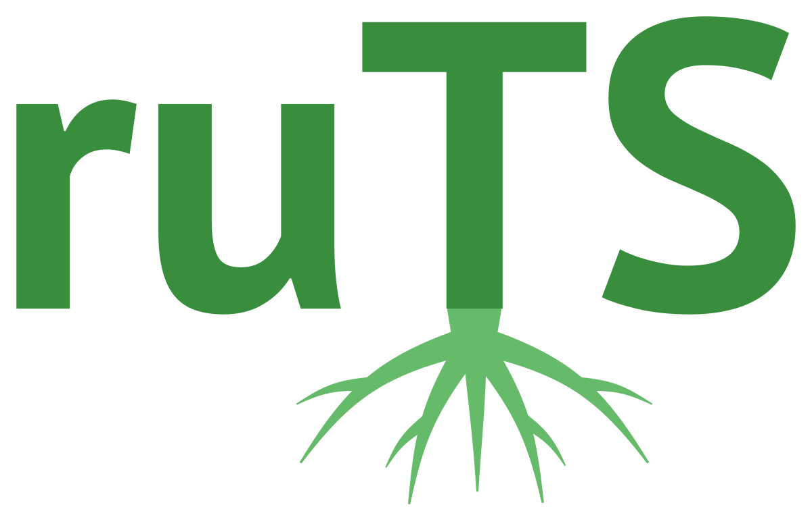
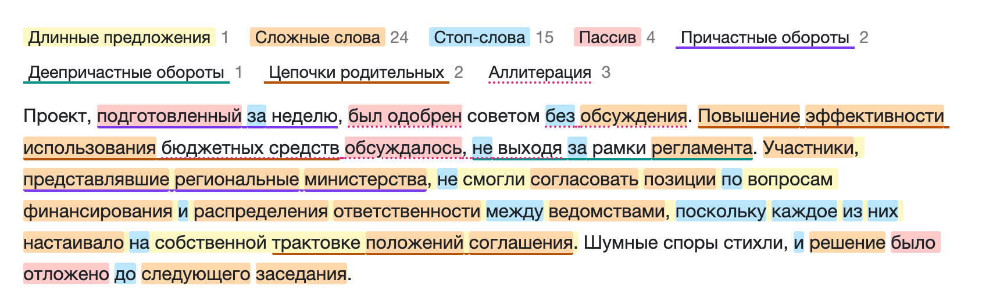
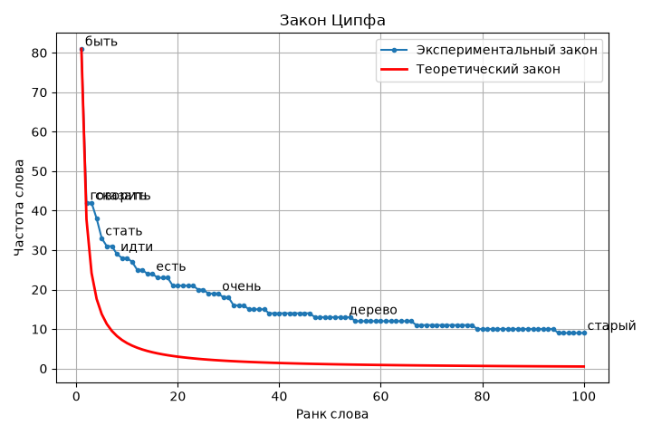

<p align="center">
  
</p>

<h1 align="center">ruTS</h1>

<p align="center">
  <b>Russian Texts Statistics</b> - библиотека для извлечения статистик из текстов на русском языке
</p>

<p align="center">
  <a href="https://sergeyshk.github.io/ruTS/">Документация</a> ·
  <a href="https://huggingface.co/spaces/SergeyShk/ruTS">Демо</a> ·
  <a href="https://pypi.org/project/ruts/">PyPI</a> ·
  <a href="https://github.com/SergeyShk/ruTS/blob/master/README.en.md">English</a>
</p>

<p align="center">
  <a href="https://pypi.org/project/ruts/"></a>
  <a href="https://pypi.org/project/ruts/"></a>
  <a href="https://github.com/SergeyShk/ruTS/actions/workflows/ci.yml"></a>
  <a href="https://github.com/astral-sh/ruff"></a>
  <a href="https://github.com/SergeyShk/ruTS/blob/master/LICENSE.txt"></a>
  
  <a href="https://huggingface.co/spaces/SergeyShk/ruTS"></a>
  <a href="https://colab.research.google.com/github/SergeyShk/ruTS/blob/master/examples/01_text_walkthrough.ipynb"></a>
  <a href="https://doi.org/10.5281/zenodo.22837587"></a>
</p>

---

**ruTS** считает по русскому тексту то, для чего обычно нужно несколько разных инструментов: от базовых статистик, удобочитаемости и лексического разнообразия до морфологии, синтаксиса, связности, стилометрии и корпусных мер - по опубликованным формулам, адаптированным для русского языка.

Источник - строка или `Doc` [spaCy](https://github.com/explosion/spaCy); каждая статистика доступна и как класс, и как компонент пайплайна spaCy.

Попробовать без установки можно в [демо на Hugging Face Spaces](https://huggingface.co/spaces/SergeyShk/ruTS): класс удобочитаемости, метрики, графики и подсветка фрагментов вставленного текста.

* **[Извлечение объектов](https://sergeyshk.github.io/ruTS/extractors/words/)** - настраиваемые токенизаторы слов, предложений и символьных N-грамм
* **[Базовые статистики](https://sergeyshk.github.io/ruTS/stats/basic_stats/)** - количество слов, предложений, слогов, знаков препинания и их распределения
* **[Метрики удобочитаемости](https://sergeyshk.github.io/ruTS/stats/readability_stats/)** - тест Флеша-Кинкайда, индекс SMOG, LIX и другие с коэффициентами для русского языка, формулы других языков
* **[Метрики лексического разнообразия](https://sergeyshk.github.io/ruTS/stats/diversity_stats/)** - TTR и его вариации, MTLD, HD-D, индексы Симпсона и Юла, энтропия, законы Ципфа и Хипса
* **[Морфологические статистики](https://sergeyshk.github.io/ruTS/stats/morph_stats/)** - часть речи, падеж, наклонение, переходность и другие признаки в терминах Universal Dependencies
* **[SEO-метрики стиля](https://sergeyshk.github.io/ruTS/stats/style_stats/)** - тошнота, водность, заспамленность, естественность по Ципфу, плотность ключевых слов, маркеры канцелярита
* **[Фоностатистики](https://sergeyshk.github.io/ruTS/stats/phon_stats/)** - классы звуков, кластеры, аллитерация и ассонанс, слоги
* **[Синтаксические статистики](https://sergeyshk.github.io/ruTS/stats/syntax_stats/)** - длины зависимостей, глубина дерева, клаузы, обороты, пассив, цепочки родительных падежей и другие маркеры канцелярита по разбору spaCy
* **[Статистики связности](https://sergeyshk.github.io/ruTS/stats/cohesion_stats/)** - повторы слов между предложениями, данность, темпоральная связность, коннекторы
* **[Статистики лексической сложности](https://sergeyshk.github.io/ruTS/stats/lexical_stats/)** - частотность слов по словарю Ляшевской и Шарова, частотные полосы, сюрпризал, лексическая плотность
* **[Стиховедческие статистики](https://sergeyshk.github.io/ruTS/stats/verse_stats/)** - ударения по словарю Козиева, метр, профиль ударности, схемы рифмовки, строфы
* **[Корпусные меры](https://sergeyshk.github.io/ruTS/corpus/keyness/)** - ключевые слова, коллокации, дисперсия слов, конкорданс KWIC, стилометрия, сравнение корпусов по всем признакам с размерами эффектов
* **[Наборы данных](https://sergeyshk.github.io/ruTS/datasets/sovchlit/)** - готовые предобработанные корпуса с фильтрацией
* **[Визуализации](https://sergeyshk.github.io/ruTS/visualizers/zipf/)** - закон Ципфа, литературная дактилоскопия, дерево слов, подсветка текста в стиле Главреда, корпусные и стилометрические графики
* **[Компоненты spaCy](https://sergeyshk.github.io/ruTS/components/)** - встраивание любой статистики в пайплайн

## Установка

Требуется Python 3.11 или новее.

```bash
pip install ruts
```

Или с помощью [uv](https://docs.astral.sh/uv/):

```bash
uv add ruts
```

Компонентам spaCy и синтаксическим статистикам нужна русскоязычная модель (большие `md` и `lg` статистики почти не меняют, подробнее - на странице [Установка](https://sergeyshk.github.io/ruTS/installation/)):

```bash
python -m spacy download ru_core_news_sm
```

Для `Doc` рекомендуется [конвейер](https://sergeyshk.github.io/ruTS/components/#load_pipeline) `ruts.load_pipeline()`: токены и предложения в нём даёт сегментатор [anySeg](https://github.com/SergeyShk/anySeg), морфологию - анализатор [ruMorph](https://github.com/SergeyShk/ruMorph), а модель - разбор зависимостей, так что `Doc` размечается почти как строка. С обычным `spacy.load("ru_core_news_sm")` морфологию даёт модель.

## Быстрый старт

```python
>>> from ruts import BasicStats, DiversityStats, ReadabilityStats

>>> text = "Существуют три вида лжи: ложь, наглая ложь и статистика"

>>> BasicStats(text).get_stats()
{'c_letters': {1: 1, 3: 2, 4: 3, 6: 1, 10: 2},
 'c_syllables': {1: 5, 2: 1, 3: 1, 4: 2},
 'n_sents': 1,
 'n_words': 9,
 'n_unique_words': 8,
 'n_long_words': 3,
 'n_complex_words': 2,
 'n_simple_words': 7,
 'n_monosyllable_words': 5,
 'n_polysyllable_words': 4,
 'n_chars': 55,
 'n_letters': 45,
 'n_spaces': 8,
 'n_syllables': 18,
 'n_punctuations': 2,
 'letters_entropy': 2.197159723424149,
 'syllables_entropy': 1.6577427265048887,
 'c_punctuations': {'comma': 1, 'period': 0, 'question': 0, 'exclamation': 0,
                    'ellipsis': 0, 'colon': 1, 'semicolon': 0, 'dash': 0,
                    'hyphen': 0, 'angle_quotes': 0, 'straight_quotes': 0,
                    'parentheses': 0, 'other': 0}}

>>> ReadabilityStats(text).flesch_reading_easy
74.93500000000003

>>> DiversityStats(text).ttr
0.8888888888888888
```

Разбор одного рассказа всеми инструментами библиотеки - в ноутбуке [examples/01_text_walkthrough.ipynb](https://github.com/SergeyShk/ruTS/blob/master/examples/01_text_walkthrough.ipynb) (открывается в [Colab](https://colab.research.google.com/github/SergeyShk/ruTS/blob/master/examples/01_text_walkthrough.ipynb)), остальные ноутбуки - на странице [примеров](https://sergeyshk.github.io/ruTS/examples/).

## Возможности

### Извлечение объектов

Настраиваемые экстракторы предложений, слов и символьных N-грамм используются в статистиках и стилометрии.

```python
>>> import re
>>> from ruts import CharNgramsExtractor, SentsExtractor, WordsExtractor

>>> text = "Не имей 100 рублей, а имей 100 друзей"

>>> se = SentsExtractor(tokenizer=re.compile(r', '))
>>> se.extract(text)
('Не имей 100 рублей', 'а имей 100 друзей')

>>> we = WordsExtractor(use_lexemes=True, stopwords=["не", "а"], filter_nums=True, ngram_range=(1, 2))
>>> we.extract(text)
('иметь', 'рубль', 'иметь', 'друг', 'иметь_рубль', 'рубль_иметь', 'иметь_друг')

>>> we.get_most_common(3)
[('иметь', 2), ('рубль', 1), ('друг', 1)]

>>> ce = CharNgramsExtractor(n=3, lowercase=True)
>>> ce.extract(text)[:5]
('не ', 'е и', ' им', 'име', 'мей')
>>> ce.get_most_common(2)
[(' им', 2), ('име', 2)]
```

Подробнее - в документации: [слова](https://sergeyshk.github.io/ruTS/extractors/words/), [предложения](https://sergeyshk.github.io/ruTS/extractors/sentences/), [символьные N-граммы](https://sergeyshk.github.io/ruTS/extractors/char_ngrams/).

<details>
<summary><b>Базовые статистики</b></summary>

<br>

Количество предложений, слов, слогов, символов и знаков препинания, распределения слов по числу букв и слогов, энтропия длин слов. Статистики можно вывести на экран в читаемом виде:

```python
>>> from ruts import BasicStats

>>> text = "Существуют три вида лжи: ложь, наглая ложь и статистика"
>>> BasicStats(text).print_stats()
            Статистика            | Значение
---------------------------------------------
Предложения                       |    1
Слова                             |    9
Уникальные слова                  |    8
Длинные слова                     |    3
Сложные слова                     |    2
Простые слова                     |    7
Односложные слова                 |    5
Многосложные слова                |    4
Символы                           |    55
Буквы                             |    45
Пробелы                           |    8
Слоги                             |    18
Знаки препинания                  |    2
Энтропия длин слов в буквах (бит) |   2.20
Энтропия длин слов в слогах (бит) |   1.66
```

Подробнее - в [документации](https://sergeyshk.github.io/ruTS/stats/basic_stats/).

</details>

<details>
<summary><b>Метрики удобочитаемости</b></summary>

<br>

Двенадцать формул - от теста Флеша-Кинкайда, индекса SMOG и LIX до формул Мацковского и Тулдавы (полный список - в выводе `print_stats` ниже). [Формулы других языков](https://sergeyshk.github.io/ruTS/stats/unadapted_readability_stats/) (`UnadaptedReadabilityStats`) - FORCAST, Венские формулы, Gulpease и другие - считаются с исходными коэффициентами, без калибровки под русский язык: они годятся для сравнения текстов, но не для класса российской школы.

Поверх формул - сводный класс, возраст читателя, шкалы индекса Флеша, LIX и RIX, время чтения и [нормы ступеней](https://sergeyshk.github.io/ruTS/stats/readability_stats/#level_norms) школы.

Коэффициенты адаптированных формул задаются [пресетом](https://sergeyshk.github.io/ruTS/stats/readability_stats/#presets) `preset`: `plainrussian` (по умолчанию, проект [Plain Russian Language](https://github.com/infoculture/plainrussian)), `fiction` (Оборнева, художественные тексты) и `academic` (Соловьёв, Иванов, Солнышкина, учебники).

```python
>>> from pprint import pprint
>>> from ruts import ReadabilityStats

>>> text = "Ног нет, а хожу, рта нет, а скажу: когда спать, когда вставать, когда работу начинать"
>>> rs = ReadabilityStats(text)

>>> pprint(rs.get_stats())
{'automated_readability_index': 0.2941666666666656,
 'coleman_liau_index': 1.1700000000000053,
 'consensus_grade': 1.5,
 'dale_chall_index': 4.095000000000001,
 'flesch_kincaid_grade': -2.0633333333333326,
 'flesch_reading_easy': 87.16833333333334,
 'gunning_fog_index': 6.0,
 'lix': 28.333333333333336,
 'matskovsky_index': 9.351,
 'reading_time': 0.08333333333333333,
 'rix': 2.0,
 'sis_grade': 1.5166666666666675,
 'smog_index': 0.05,
 'tuldava': 1.9601520984261356}

>>> rs.print_stats()
                Метрика                 | Значение
---------------------------------------------------
Тест Флеша-Кинкайда                     |  -2.06
Индекс удобочитаемости Флеша            |  87.17
Индекс Колман-Лиау                      |   1.17
Индекс SMOG                             |   0.05
Автоматический индекс удобочитаемости   |   0.29
Индекс удобочитаемости LIX              |  28.33
Индекс удобочитаемости RIX              |   2.00
Формула Соловьёва, Иванова, Солнышкиной |   1.52
Формула Мацковского                     |   9.35
Формула Тулдавы                         |   1.96
Индекс Дейла-Чейла                      |   4.10
Индекс Ганнинга                         |   6.00
Сводный класс                           |   1.50
Время чтения (мин.)                     |   0.08

>>> rs.describe_grade()
'1-3-й класс (6-8 лет)'

>>> rs.describe("flesch_reading_easy"), rs.describe("lix")
('6-й класс', 'очень простые тексты, детские книги')
```

Подробнее - в [документации](https://sergeyshk.github.io/ruTS/stats/readability_stats/).

</details>

<details>
<summary><b>Метрики лексического разнообразия</b></summary>

<br>

*   Type-Token Ratio (TTR) и его вариации: RTTR, CTTR, HTTR, STTR, MTTR, DTTR, MATTR, MSTTR
*   MTLD, MA-MTLD, MTLD-W и HD-D
*   Индексы Симпсона, гапакс-индекс, меры Баайена, Юла, Хердана, Сишела, Мишеа, Брюне, Дюга и Орлова
*   Энтропия Шеннона, выравненность, перплексия и взрывность частых лексем
*   Наклон закона Ципфа (α) и показатель закона Хипса (β)

Любую метрику можно посчитать по окнам с доверительным интервалом методом `windowed`. Часть реализаций взята из проекта [lexical_diversity](https://github.com/kristopherkyle/lexical_diversity).

```python
>>> from pprint import pprint
>>> from ruts import DiversityStats

>>> text = "Ног нет, а хожу, рта нет, а скажу: когда спать, когда вставать, когда работу начинать"

>>> pprint(DiversityStats(text).get_stats())
{'alpha2': 0.5,
 'baayen_p': 0.5333333333333333,
 'brunet_w': 6.00637847898991,
 'burstiness': nan,
 'cttr': 2.008316044185609,
 'dttr': 10.268784661968118,
 'dugast_k': 14.783895126869226,
 'entropy': 3.3232314287976203,
 'evenness': 0.9606293157795304,
 'gini_simpson_index': 0.9523809523809523,
 'hapax_index': 992.9517404041437,
 'hapax_ratio': 0.7272727272727273,
 'hdd': nan,
 'heaps_beta': 0.8366147342060046,
 'herdan_vm': 0.1421338109037403,
 'httr': 0.8854692840710255,
 'inverse_simpson_index': 21.0,
 'mamtld': 12.0,
 'mattr': 0.7333333333333333,
 'michea_m': 5.5,
 'msttr': 0.7333333333333333,
 'mtld': 15.0,
 'mtldw': 13.25,
 'mttr': 0.09738250756232528,
 'orlov_z': nan,
 'perplexity': 10.009038104159247,
 'rttr': 2.840187787218772,
 'sichel_s': 0.18181818181818182,
 'simpson_index': 0.047619047619047616,
 'sttr': 0.2500605793160848,
 'ttr': 0.7333333333333333,
 'yule_i': 8.642857142857142,
 'yule_k': 444.44444444444446,
 'zipf_alpha': 0.4884512334695912}

>>> DiversityStats(text).windowed("ttr", window_len=5)
WindowStats(mean=0.9333333333333332, std=0.11547005383792512, lower=0.6464898180167025, upper=1.220176848649964, n_windows=3)
```

Подробнее - в [документации](https://sergeyshk.github.io/ruTS/stats/diversity_stats/).

</details>

<details>
<summary><b>Морфологические статистики</b></summary>

<br>

Часть речи и 15 признаков - падеж, вид, время, наклонение, переходность и другие - в терминах [Universal Dependencies](https://universaldependencies.org/u/feat/): для `Doc` с разметкой из `token.pos_` и `token.morph`, для строки - из разбора [ruMorph](https://github.com/SergeyShk/ruMorph) в контексте предложения.

```python
>>> from pprint import pprint
>>> from ruts import MorphStats

>>> text = "Постарайтесь получить то, что любите, иначе придется полюбить то, что получили"
>>> ms = MorphStats(text)

>>> ms.pos
('VERB', 'VERB', 'PRON', 'PRON', 'VERB', 'ADV', 'VERB', 'VERB', 'PRON', 'PRON', 'VERB')

>>> pprint(ms.get_stats())
{'animacy': {None: 7, 'Inan': 4},
 'aspect': {None: 5, 'Imp': 1, 'Perf': 5},
 'case': {None: 7, 'Acc': 4},
 'degree': {None: 10, 'Pos': 1},
 'gender': {None: 7, 'Neut': 4},
 'involvement': {None: 10, 'Ex': 1},
 'mood': {None: 7, 'Imp': 1, 'Ind': 3},
 'number': {None: 3, 'Plur': 3, 'Sing': 5},
 'person': {None: 8, '2': 2, '3': 1},
 'polarity': {None: 11},
 'pos': {'ADV': 1, 'PRON': 4, 'VERB': 6},
 'style_variant': {None: 11},
 'tense': {None: 8, 'Fut': 1, 'Past': 1, 'Pres': 1},
 'transitivity': {None: 5, 'Intr': 2, 'Tran': 4},
 'verb_form': {None: 5, 'Fin': 4, 'Inf': 2},
 'voice': {None: 5, 'Act': 4, 'Mid': 2}}

>>> ms.print_stats('pos', 'tense')
---------------Часть речи---------------
Глагол                        |    6
Местоимение-существительное   |    4
Наречие                       |    1

-----------------Время------------------
Неизвестно                    |    8
Настоящее                     |    1
Будущее                       |    1
Прошедшее                     |    1
```

Отдельные слова можно разобрать с расшифровкой признаков через `ms.explain_text(filter_none=True)`.

Подробнее - в [документации](https://sergeyshk.github.io/ruTS/stats/morph_stats/).

</details>

<details>
<summary><b>SEO-метрики стиля</b></summary>

<br>

Показатели сервисов [Advego](https://advego.com/text/seo/) и [Text.ru](https://text.ru/seo) по общепринятым определениям (формулы сервисов не опубликованы):

*   Классическая и академическая тошнота, водность, заспамленность
*   Естественность по закону Ципфа, плотность ключевых слов и фраз
*   Лексические маркеры канцелярита: отглагольные существительные, производные предлоги, вводные слова, штампы
*   Прочтение метрик по нормам сервисов

```python
>>> from pprint import pprint
>>> from ruts import StyleStats

>>> text = "Ног нет, а хожу, рта нет, а скажу: когда спать, когда вставать, когда работу начинать"
>>> ss = StyleStats(text)

>>> pprint(ss.get_stats())
{'academic_nausea': 53.333333333333336,
 'classic_nausea': 1.7320508075688772,
 'cliches': 0.0,
 'compound_prepositions': 0.0,
 'parentheticals': 0.0,
 'spam': 26.666666666666668,
 'verbal_nouns': 0.0,
 'water': 33.333333333333336,
 'zipf_naturalness': 33.333333333333336}

>>> ss.keyword_density("когда", "нет а")
{'когда': 20.0, 'нет а': 13.333333333333334}

>>> ss.describe("water"), ss.describe("spam")
('высокая водность по Text.ru', 'естественный текст по Text.ru')

>>> ss = StyleStats("В целях повышения качества в кратчайшие сроки, как правило, проводится проверка")
>>> ss.verbal_nouns, ss.compound_prepositions, ss.parentheticals, ss.cliches
(16.666666666666664, 9.090909090909092, 9.090909090909092, 9.090909090909092)
>>> ss.markers()
{'verbal_nouns': ('повышения',),
 'compound_prepositions': ('в целях',),
 'parentheticals': ('как правило',),
 'cliches': ('в кратчайшие сроки',)}
```

Подробнее - в [документации](https://sergeyshk.github.io/ruTS/stats/style_stats/).

</details>

<details>
<summary><b>Фоностатистики</b></summary>

<br>

По буквам, без учета оглушения и ударения:

*   Доли гласных, сонорных, звонких и глухих согласных, отношение согласных к гласным
*   Консонантные кластеры и зияния гласных
*   Энтропия CV-шаблонов слов и «жёсткость»
*   Индексы аллитерации и ассонанса относительно ожидаемых повторов
*   Слоги по правилу восходящей звучности: доля открытых слогов, средняя длина слога

```python
>>> from pprint import pprint
>>> from ruts import PhonStats
>>> from ruts.syllables import syllabify

>>> text = "Ног нет, а хожу, рта нет, а скажу: когда спать, когда вставать, когда работу начинать"
>>> ps = PhonStats(text)

>>> pprint(ps.get_stats())
{'alliteration': 1.0916179337231968,
 'assonance': 0.8305084745762712,
 'consonant_vowel_ratio': 1.48,
 'cv_entropy': 3.1395722619867223,
 'hardness': 0.5625,
 'mean_syllable_len': 2.48,
 'p_heavy_clusters': 0.034482758620689655,
 'p_hiatus': 0.0,
 'p_open_syllables': 0.76,
 'p_sonorants': 0.11290322580645161,
 'p_voiced': 0.1935483870967742,
 'p_voiceless': 0.2903225806451613,
 'p_vowels': 0.4032258064516129}

>>> syllabify("здравствуйте")
['здра', 'вствуй', 'те']
```

Подробнее - в [документации](https://sergeyshk.github.io/ruTS/stats/phon_stats/).

</details>

<details>
<summary><b>Синтаксические статистики</b></summary>

<br>

По дереву зависимостей spaCy (нужна модель с парсером и частями речи):

*   Длины зависимостей, глубина дерева, валентность глаголов
*   Сочинительные цепочки, клаузы и придаточные, индексы L2SCA
*   Модификаторы именной группы, предложные цепочки и цепочки родительных падежей
*   Порядок слов, синтаксическая схожесть соседних предложений
*   Причастные и деепричастные обороты, пассив, инфинитивы и отрицания
*   Синтаксические маркеры канцелярита: расщеплённые сказуемые («осуществлять проверку»), отношение существительных к глаголам

```python
>>> from ruts import SyntaxStats, load_pipeline

>>> nlp = load_pipeline()
>>> text = "Дом, построенный рабочими в прошлом году, был продан. Он сказал, что не придёт, и ушёл, хлопнув дверью."
>>> ss = SyntaxStats(nlp(text))

>>> ss.tree_depth, ss.mean_dependency_distance
(4.0, 1.9333333333333333)
>>> ss.clauses_per_sent, ss.subordinate_clauses_per_sent
(2.0, 1.0)
>>> ss.participle_clauses_per_sent, ss.converb_clauses_per_sent, ss.p_passive
(0.5, 0.5, 0.3333333333333333)
```

Подробнее - в [документации](https://sergeyshk.github.io/ruTS/stats/syntax_stats/).

</details>

<details>
<summary><b>Статистики связности</b></summary>

<br>

Без разбора зависимостей, по образцу Coh-Metrix и TAACO:

*   Повторы существительных, аргументов и знаменательных слов между предложениями и абзацами
*   Данность: доли местоимений, указательных и уже встречавшихся знаменательных слов, отношение местоимений к существительным
*   Темпоральная связность: повтор времени и вида глаголов в соседних предложениях
*   Плотность коннекторов на 1000 слов по семи классам (причинные, противительные и другие), типам и позиции - по собственному словарю из 316 единиц

```python
>>> from ruts import CohesionStats

>>> text = "Кот сидел на окне. Он смотрел на птиц. Птицы улетели, и кот уснул. Завтра он снова будет сидеть на этом окне."
>>> cs = CohesionStats(text)

>>> cs.noun_overlap_adjacent, cs.noun_overlap_all
(0.3333333333333333, 0.5)
>>> cs.argument_overlap_all, cs.content_overlap_prop_adjacent
(0.6666666666666666, 0.1111111111111111)
>>> cs.p_pronouns, cs.p_given, cs.temporal_cohesion
(0.14285714285714285, 0.2857142857142857, 0.5)

>>> cs = CohesionStats("Кот ждал птиц, потому что был голоден. Однако птицы улетели, и всё же кот не ушёл.")
>>> cs.connectors_causal, cs.connectors_adversative, cs.connectors_concessive
(62.5, 62.5, 62.5)
```

Подробнее - в [документации](https://sergeyshk.github.io/ruTS/stats/cohesion_stats/).

</details>

<details>
<summary><b>Статистики лексической сложности</b></summary>

<br>

Насколько слова текста редки относительно языка (lexical sophistication по образцу TAALES):

*   Средняя частотность, диапазон и дисперсия лемм по частотному словарю Ляшевской и Шарова (загружается один раз: `FreqDict().download()`)
*   Доли слов из частотных полос от топ-1000 до топ-10000 по вшитому списку Шарова - без загрузки словаря
*   Сюрпризал и перплексия, покрытие словарём, лексическая плотность
*   Формула Соловьёва, Иванова, Солнышкиной с частотностью - `ReadabilityStats.sis_grade_by_freq`

```python
>>> from ruts import LexicalStats
>>> from ruts.datasets import FreqDict

>>> FreqDict().download()
>>> ls = LexicalStats("Кот сидел на окне и смотрел на птиц")

>>> ls.mean_ipm_content, ls.mean_log_ipm, ls.surprisal
(324.18, 3.0674194359404705, 9.74182176626998)
>>> ls.p_top1000, ls.p_top10000, ls.lexical_density
(0.75, 1.0, 0.625)

>>> LexicalStats("Фелинолог пребывал на подоконнике").p_beyond_top10000
0.25
```

Подробнее - в [документации](https://sergeyshk.github.io/ruTS/stats/lexical_stats/).

</details>

<details>
<summary><b>Стиховедческие статистики</b></summary>

<br>

Ударения, метр и рифма для силлабо-тонического стиха:

*   Ударения по знаку ударения в тексте, по букве ё и по словарю Ильи Козиева (1,68 млн словоформ, загружается один раз: `StressDict().download()`)
*   Метр по алгоритму Барахнина - от ямба до анапеста, `None` для дольника, верлибра и прозы; число стоп, пиррихии, профиль ударности
*   Схемы рифмовки (`ABAB`, `-A-A`), типы окончаний, строфы
*   На наборе RIFMA ударения совпадают с ручной разметкой у 97% слов, рифмы находятся с точностью 94% и полнотой 90%

```python
>>> from ruts import VerseStats
>>> from ruts.datasets import StressDict

>>> StressDict().download()
>>> text = """Тучки небесные, вечные странники!
... Степью лазурною, цепью жемчужною
... Мчитесь вы, будто как я же, изгнанники,
... С милого севера в сторону южную."""
>>> vs = VerseStats(text)

>>> vs.meter, vs.n_feet, vs.rhyme_schemes, vs.c_clausulas
('дактиль', 4, ('ABAB',), {'дактилическая': 4})
>>> vs.patterns[0]
'CccCccCccCcc'
>>> print(vs.accentuate())
Ту́чки небе́сные, ве́чные стра́нники!
Сте́пью лазу́рною, це́пью жемчу́жною
Мчи́тесь вы, бу́дто как я́ же, изгна́нники,
С ми́лого се́вера в сто́рону ю́жную.
```

Подробнее - в [документации](https://sergeyshk.github.io/ruTS/stats/verse_stats/).

</details>

<details>
<summary><b>Корпусные меры</b></summary>

<br>

Функции подпакета `ruts.corpus` над списками слов; результаты - списки именованных кортежей (`pd.DataFrame(result)` даёт таблицу):

*   Ключевые слова относительно эталонного корпуса или частотного словаря Ляшевской и Шарова: G², Log Ratio, %DIFF и другие меры
*   Коллокации в окне по logDice, MI, t-score и другим мерам ассоциации, сочетаемость одного слова
*   Дисперсия слов по частям текста: DP Гриса, D Жюйана и другие
*   Конкорданс KWIC по словоформе или лемме; подгонка закона Ципфа-Мандельброта - `fit_zipf_mandelbrot` в `ruts.diversity_stats`
*   Стилометрия: дельта Барроуза с вариантами и скользящая дельта, Zeta, хи-квадрат Килгарриффа, кривая Менденхолла, профиль служебных слов
*   Сравнение корпусов `compare_corpora` по 147 признакам текста (с пайплайном spaCy - и по синтаксису): критерий Манна-Уитни с поправкой Холма, размеры эффектов и бутстрэп-интервалы

```python
>>> from ruts import WordsExtractor
>>> from ruts.corpus import keyness, collocations, dispersion, kwic, print_kwic, delta, zeta

>>> we = WordsExtractor(use_lexemes=True, lowercase=True)
>>> text = "Кот сидел на окне и смотрел на птиц. Птицы улетели, и кот уснул на окне. Завтра кот снова будет сидеть на окне и смотреть на птиц."
>>> target = we.extract(text)
>>> reference = we.extract("Собака лежала на полу и дремала. Потом собака ела и снова дремала. Завтра собака будет гулять.")

>>> [(k.word, round(k.g2, 2), round(k.log_ratio, 2)) for k in keyness(target, reference, top_n=2)]
[('кот', 2.88, 1.88), ('окно', 2.88, 1.88)]
>>> [(c.left, c.right, c.freq_pair, round(c.score, 2)) for c in collocations(target, window=2, top_n=2)]
[('птица', 'улететь', 2, 13.0), ('и', 'смотреть', 2, 12.68)]
>>> [(d.word, round(d.dp, 2)) for d in dispersion(target, parts=3, min_freq=3)][:3]
[('на', 0.15), ('кот', 0.32), ('окно', 0.03)]
>>> print_kwic(kwic(text, "окно", by_lemma=True, window=2), width=16)
        сидел на  окне  и смотрел
        уснул на  окне  . Завтра кот
       сидеть на  окне  и смотреть

>>> both = we.extract("Кот и собака дремали на окне. Завтра кот будет смотреть на птиц, а собака - спать на полу.")
>>> delta({"кот": target, "собака": reference, "кот и собака": both}, n_mfw=10).round(2)
               кот  собака  кот и собака
кот           0.00    1.74          0.96
собака        1.74    0.00          1.11
кот и собака  0.96    1.11          0.00
>>> [(z.word, round(z.zeta, 2)) for z in zeta(target, reference, segment_size=5, top_n=2)]
[('на', 0.67), ('кот', 0.6)]
```

Подробнее - в документации: [корпусные меры](https://sergeyshk.github.io/ruTS/corpus/keyness/), [стилометрия](https://sergeyshk.github.io/ruTS/corpus/stylometry/).

</details>

<details>
<summary><b>Наборы данных</b></summary>

<br>

Предобработанные наборы данных:

*   [sov_chrest_lit](https://sergeyshk.github.io/ruTS/datasets/sovchlit/) - советские хрестоматии по литературе
*   [stalin_works](https://sergeyshk.github.io/ruTS/datasets/stalinworks/) - полное собрание сочинений И.В. Сталина
*   [freq2011](https://sergeyshk.github.io/ruTS/datasets/freq2011/) - частотный словарь Ляшевской и Шарова: 52 138 лемм по НКРЯ
*   [texts_by_grade](https://sergeyshk.github.io/ruTS/datasets/textsbygrade/) - тексты с метками класса проекта Plain Russian Language (CC0)
*   [poetry_corpus](https://sergeyshk.github.io/ruTS/datasets/poetrycorpus/) - корпус русской поэзии PoetryCorpus Ильи Гусева: 16 694 стихотворения 195 авторов (Apache-2.0)
*   [russian_literature](https://sergeyshk.github.io/ruTS/datasets/russianliterature/) - собрание русской классической литературы RusLit: 373 произведения 12 авторов (общественное достояние)
*   [stress_dict](https://sergeyshk.github.io/ruTS/datasets/stressdict/) - словарь ударений Ильи Козиева: 1,68 млн словоформ (CC0)

Тексты выдаются чистыми или записями с метаданными, с фильтрацией по разным критериям.

```python
>>> from pprint import pprint
>>> from ruts.datasets import SovChLit

>>> sc = SovChLit()
>>> sc.info
{'Наименование': 'sov_chrest_lit',
 'url': 'https://dataverse.harvard.edu/file.xhtml?fileId=3670902&version=DRAFT',
 'description': 'Корпус советских хрестоматий по литературе',
 'author': 'Шкарин С.С.'}

>>> for record in sc.get_records(max_len=100, category='Весна', limit=1):
...     pprint(record)
{'author': 'С. Маршак',
 'book': 'Родная речь. Книга для чтения в I классе начальной школы',
 'category': 'Весна',
 'file': PosixPath('.../ruts_data/texts/sov_chrest_lit_v1/grade_1/114'),
 'grade': 1,
 'subject': 'Март',
 'text': 'Рыхлый снег темнеет в марте, тают льдинки на окне.\n'
         'Зайчик бегает по парте и по карте на стене.',
 'type': 'Стихотворение',
 'year': 1963}
```

Набор скачивается один раз методом `download()`; до загрузки `get_texts()` и `get_records()` поднимают `DatasetNotFoundError` с подсказкой.

</details>

<details>
<summary><b>Визуализации</b></summary>

<br>

Виды графиков:

*   [Закон Ципфа](https://sergeyshk.github.io/ruTS/visualizers/zipf/)
*   [Литературная дактилоскопия](https://sergeyshk.github.io/ruTS/visualizers/fingerprinting/)
*   [Дерево слов](https://sergeyshk.github.io/ruTS/visualizers/word_tree/)
*   [Подсветка текста](https://sergeyshk.github.io/ruTS/visualizers/highlight/) по 15 слоям в пяти группах: читаемость, синтаксис, канцелярит, стиль, фоника
*   [Корпусные графики](https://sergeyshk.github.io/ruTS/visualizers/corpus/): лексическая дисперсия, диаграмма ключевых слов, сеть коллокаций
*   [Стилометрические графики](https://sergeyshk.github.io/ruTS/visualizers/stylometry/): дендрограмма и главные компоненты по дельте, скользящая дельта, маркеры Zeta, кривые Менденхолла
*   [Рост словаря и спектр частот](https://sergeyshk.github.io/ruTS/visualizers/vocabulary/), [длины предложений](https://sergeyshk.github.io/ruTS/visualizers/sentences/) со скользящим средним

Графики matplotlib принимают оси `ax` и возвращают `Axes`. Подсветка отображается в Jupyter как HTML с легендой; по умолчанию включены шесть слоёв, `layers="all"` включает все, синтаксическим слоям нужен `Doc` с разбором зависимостей:

```python
>>> from ruts import load_pipeline
>>> from ruts.visualizers import highlight

>>> nlp = load_pipeline()
>>> text = (
...     "Проект, подготовленный за неделю, был одобрен советом без обсуждения. "
...     "Повышение эффективности использования бюджетных средств обсуждалось, не выходя за рамки регламента. "
...     "Участники, представлявшие региональные министерства, не смогли согласовать позиции по вопросам "
...     "финансирования и распределения ответственности между ведомствами, поскольку каждое из них "
...     "настаивало на собственной трактовке положений соглашения. "
...     "Споры стихли, в кулуарах шумно шептались и шушукались, а решение было отложено до следующего заседания."
... )
>>> ht = highlight(nlp(text))
>>> ht.counts
{'long_sents': 1, 'complex_words': 26, 'passive': 4, 'genitive_chains': 2, 'split_predicates': 0, 'cliches': 1}
>>> highlight(nlp(text), layers=["verbal_nouns", "connectors", "rare_words"]).counts
{'rare_words': 3, 'verbal_nouns': 10, 'connectors': 4}
>>> ht  # в Jupyter отобразится подсветка, разметка доступна через ht.to_html()
```

<p align="center">
  
</p>

```python
>>> from collections import Counter
>>> from ruts import WordsExtractor
>>> from ruts.datasets import SovChLit
>>> from ruts.style_stats import is_stopword
>>> from ruts.visualizers import zipf

>>> sc = SovChLit()
>>> text = "\n".join(text for text in sc.get_texts(limit=100))
>>> we = WordsExtractor(use_lexemes=True, filter_nums=True)
>>> tokens_with_count = Counter(word for word in we.extract(text) if not is_stopword(word))
>>> zipf(tokens_with_count, num_words=100, num_labels=10, log=False, show_theory=True, alpha=1.1)
```

<p align="center">
  
</p>

</details>

<details>
<summary><b>Компоненты spaCy</b></summary>

<br>

Каждый класс статистик, от `BasicStats` до `VerseStats`, встраивается в пайплайн компонентом (`ruts_basic`, `ruts_readability` и другие):

```python
>>> import ruts

>>> nlp = ruts.load_pipeline()
>>> nlp.add_pipe("ruts_basic", name="basic", last=True)

>>> doc = nlp("Существуют три вида лжи: ложь, наглая ложь и статистика")
>>> doc._.basic.c_letters
{1: 1, 3: 2, 4: 3, 6: 1, 10: 2}

>>> doc._.basic.n_words
9
```

Значения совпадают с примером для строки выше. Чтобы пустая строка завершала предложение `Doc` обычной модели, перед парсером ставится компонент `ruts_blank_lines`: `nlp.add_pipe("ruts_blank_lines", before="parser")`.

Подробнее - в [документации](https://sergeyshk.github.io/ruTS/components/).

</details>

## Разработка

Проект использует [uv](https://docs.astral.sh/uv/) для управления зависимостями и [ruff](https://docs.astral.sh/ruff/) для линтинга и форматирования.

```bash
git clone https://github.com/SergeyShk/ruTS.git
cd ruTS

make deps        # создать окружение и установить зависимости
make test        # запустить тесты и примеры из докстрингов (doctest)
make lint        # ruff + mypy
```

Полный список команд - `make help`.

Документация двуязычная ([mkdocs-static-i18n](https://github.com/ultrabug/mkdocs-static-i18n)): русские страницы `docs/*.md` и английские `docs/*.en.md` правятся вместе. Английские страницы разделов ядра anyTS подключают его текст, русские - переводят, подробнее - в [CONTRIBUTING.md](https://github.com/SergeyShk/ruTS/blob/master/CONTRIBUTING.md).

Версия установленной библиотеки - `ruts.__version__`. Исключения наследуют `ruts.RutsError` и встроенные классы Python (`ValueError`, `TypeError` и другие), а сообщения о загрузке наборов данных идут в логгер `anyts` и по умолчанию не выводятся - подробнее на странице [Исключения и логирование](https://sergeyshk.github.io/ruTS/exceptions/).

Перед отправкой изменений установите хуки - линтеры на коммите и тесты на пуше:

```bash
uv run pre-commit install
```

## Участие в проекте

Баг-репорты, идеи и пул-реквесты приветствуются - [issues](https://github.com/SergeyShk/ruTS/issues) открыты. Порядок работы и проверки перед пул-реквестом - в [CONTRIBUTING.md](https://github.com/SergeyShk/ruTS/blob/master/CONTRIBUTING.md), правила общения - в [кодексе поведения](https://github.com/SergeyShk/ruTS/blob/master/CODE_OF_CONDUCT.md).

<details>
<summary><b>Структура проекта</b></summary>

<br>

*   **docs** - документация по проекту
*   **ruts**:
    *   basic_stats.py - базовые текстовые статистики
    *   cohesion_stats.py - статистики связности текста
    *   components.py - компоненты spaCy
    *   constants.py - основные используемые константы
    *   diversity_stats.py - метрики лексического разнообразия текста
    *   exceptions.py - исключения библиотеки
    *   extractors.py - инструменты для извлечения объектов из текста
    *   lexical_stats.py - статистики лексической сложности текста
    *   morph_stats.py - морфологические статистики
    *   phon_stats.py - фоностатистики текста
    *   readability_stats.py - метрики удобочитаемости текста
    *   style_stats.py - SEO-метрики стиля текста
    *   syllables.py - слоги и ударение
    *   syntax_stats.py - синтаксические статистики текста
    *   unadapted_readability_stats.py - формулы удобочитаемости других языков
    *   utils.py - вспомогательные инструменты
    *   verse_stats.py - стиховедческие статистики: ударения, метр, рифма, строфика
    *   **corpus** - корпусные меры:
        *   collocations.py - коллокации и меры ассоциации
        *   compare.py - сравнение корпусов по признакам текста
        *   dispersion.py - дисперсия слов по частям текста
        *   keyness.py - ключевые слова относительно эталонного корпуса
        *   kwic.py - конкорданс KWIC
        *   stylometry.py - дельта Барроуза, Zeta и другие меры стилометрии
    *   **datasets** - наборы данных:
        *   dataset.py - базовый класс для работы с наборами данных
        *   freq2011.py - частотный словарь Ляшевской и Шарова
        *   poetry_corpus.py - корпус русской поэзии PoetryCorpus
        *   russian_literature.py - собрание русской классической литературы RusLit
        *   sov_chrest_lit.py - советские хрестоматии по литературе
        *   stalin_works.py - полное собрание сочинений И.В. Сталина
        *   stress_dict.py - словарь ударений Козиева
        *   texts_by_grade.py - тексты с метками класса проекта Plain Russian Language
    *   **resources** - вшитые лексические ресурсы (список самых частых лемм, словарь коннекторов)
    *   **visualizers** - инструменты для визуализации текстов:
        *   corpus.py - Лексическая дисперсия, ключевые слова, сеть коллокаций
        *   fingerprinting.py - Литературная дактилоскопия
        *   highlight.py - Подсветка текста
        *   sentences.py - Длины предложений
        *   stylometry.py - Дендрограмма, главные компоненты, шкалирование, расстояния внутри и между авторами, скользящая дельта, маркеры Zeta, кривые Менденхолла
        *   vocabulary.py - Закон Хипса и спектр частот
        *   word_tree.py - Дерево слов
        *   zipf.py - Закон Ципфа
*   **tests** - тесты, повторяющие структуру пакета
*   **scripts** - скрипт загрузки страниц документации anyTS
*   **examples** - ноутбуки с примерами
*   **demo** - демонстрация на Gradio для Hugging Face Spaces

</details>

## Авторы

*   Шкарин Сергей (kouki.sergey@gmail.com)
*   Смирнова Екатерина (ekanerina@yandex.ru)

## Лицензия

[MIT](https://github.com/SergeyShk/ruTS/blob/master/LICENSE.txt)

## Цитирование

Если вы используете **ruTS** в исследованиях или программах, пожалуйста, сошлитесь на библиотеку. Concept DOI [10.5281/zenodo.22837587](https://doi.org/10.5281/zenodo.22837587) на Zenodo указывает на все версии библиотеки, DOI конкретной версии - на странице релиза; метаданные лежат в [CITATION.cff](https://github.com/SergeyShk/ruTS/blob/master/CITATION.cff), GitHub показывает их по кнопке «Cite this repository».

```bibtex
@software{ruTS,
  author = {Sergey Shkarin},
  title = {{ruTS, a library for statistics extraction from texts in Russian}},
  year = 2026,
  publisher = {Moscow},
  doi = {10.5281/zenodo.22837587},
  url = {https://github.com/SergeyShk/ruTS}
}
```
