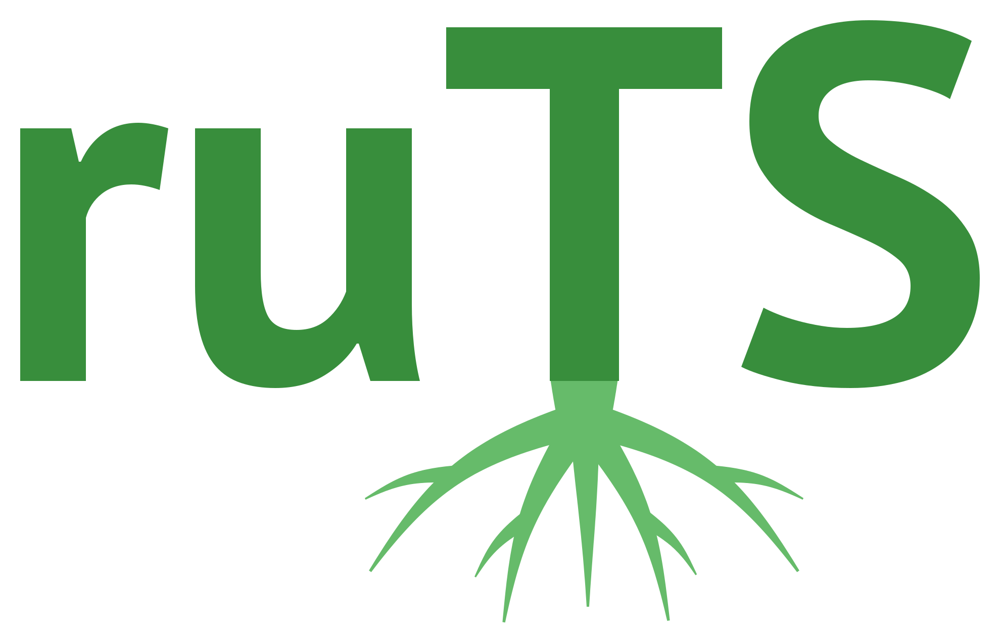

# Russian Texts Statistics (ruTS)



**ruTS** computes for Russian texts what usually requires assembling several separate tools: from basic statistics, readability and lexical diversity to morphology, syntax, cohesion, stylometry and corpus measures - by published formulas adapted to the Russian language.

The library works both with raw strings and with `Doc` objects of [spaCy](https://github.com/explosion/spaCy) - every statistic is available both as a standalone class and as a spaCy pipeline component.

Try it without installing in the [demo on Hugging Face Spaces](https://huggingface.co/spaces/SergeyShk/ruTS): paste a text and get the readability grade, metrics, plots and highlighted fragments.

## Features

<div class="grid cards" markdown>

-   :material-scissors-cutting:{ .lg .middle } __Extraction__

    ---

    Tokenizers of [words](extractors/words.md), [sentences](extractors/sentences.md) and [character N-grams](extractors/char_ngrams.md) with filters, lemmatization and N-grams

    [:octicons-arrow-right-24: Extraction](extractors/sentences.md)

-   :material-format-letter-case:{ .lg .middle } __Syllables and stress__

    ---

    Syllabification of words, the number of syllables, the stressed syllable by the dictionary and the type of the ending

    [:octicons-arrow-right-24: Syllables and stress](syllables.md)

-   :material-counter:{ .lg .middle } __Basic statistics__

    ---

    Numbers of words, sentences, punctuation marks, syllables and other basic text statistics

    [:octicons-arrow-right-24: Basic statistics](stats/basic_stats.md)

-   :material-book-open-variant:{ .lg .middle } __Readability__

    ---

    Flesch-Kincaid test, SMOG index, LIX readability index and other metrics with coefficients for Russian, and formulas of other languages with their original coefficients

    [:octicons-arrow-right-24: Readability metrics](stats/readability_stats.md)

-   :material-chart-bell-curve:{ .lg .middle } __Lexical diversity__

    ---

    Type-Token Ratio, Measure of Textual Lexical Diversity, hapax index and other metrics

    [:octicons-arrow-right-24: Lexical diversity metrics](stats/diversity_stats.md)

-   :material-alphabetical-variant:{ .lg .middle } __Morphology__

    ---

    Morphological features in Universal Dependencies terms: part of speech, case, mood, transitivity and others

    [:octicons-arrow-right-24: Morphological statistics](stats/morph_stats.md)

-   :material-feather:{ .lg .middle } __Style__

    ---

    SEO metrics: nausea, water content, spam score, naturalness by Zipf's law, keyword density

    [:octicons-arrow-right-24: SEO style metrics](stats/style_stats.md)

-   :material-waveform:{ .lg .middle } __Phonetics__

    ---

    Shares of sound classes, consonant clusters, alliteration and assonance, syllables

    [:octicons-arrow-right-24: Phonostatistics](stats/phon_stats.md)

-   :material-file-tree:{ .lg .middle } __Syntax__

    ---

    Statistics of the spaCy dependency tree: dependency distances, tree depth, coordination chains, clauses, L2SCA indices, participial clauses, passive voice, prepositional and genitive chains, word order, similarity of adjacent sentences

    [:octicons-arrow-right-24: Syntactic statistics](stats/syntax_stats.md)

-   :material-link-variant:{ .lg .middle } __Cohesion__

    ---

    Noun, argument and content word overlap between sentences and paragraphs, givenness, temporal cohesion, connectives by class, inter- and intrasentential

    [:octicons-arrow-right-24: Cohesion statistics](stats/cohesion_stats.md)

-   :material-school:{ .lg .middle } __Lexical sophistication__

    ---

    Word frequency by the Lyashevskaya-Sharoff dictionary, frequency bands, surprisal, lexical density

    [:octicons-arrow-right-24: Lexical sophistication statistics](stats/lexical_stats.md)

-   :material-music-note:{ .lg .middle } __Verse__

    ---

    Stresses by the Koziev dictionary, meter and number of feet, pyrrhics and stress profile, rhyme schemes, line endings and stanzas

    [:octicons-arrow-right-24: Verse statistics](stats/verse_stats.md)

-   :material-bookshelf:{ .lg .middle } __Corpus measures__

    ---

    [Keywords](corpus/keyness.md) relative to a reference corpus or a frequency dictionary, [collocations](corpus/collocations.md), [word dispersion](corpus/dispersion.md) across text parts, [KWIC concordance](corpus/kwic.md), [stylometry](corpus/stylometry.md) measures (Burrows's Delta with its variants and rolling Delta along a text, Zeta and the shares of its markers in segments, Kilgarriff's chi-square, Mendenhall curve, function word profile) and the [comparison of corpora](corpus/compare.md) across all features at once (Mann-Whitney test, Cohen's d, Cliff's delta, bootstrap intervals, AUC)

    [:octicons-arrow-right-24: Corpus measures](corpus/keyness.md)

-   :material-database:{ .lg .middle } __Datasets__

    ---

    [Soviet literature readers](datasets/sovchlit.md), [Collected works of Stalin](datasets/stalinworks.md), [Texts with grade labels](datasets/textsbygrade.md), [Lyashevskaya and Sharoff frequency dictionary](datasets/freq2011.md), [Russian poetry corpus](datasets/poetrycorpus.md), [Russian classical literature](datasets/russianliterature.md), [Koziev stress dictionary](datasets/stressdict.md)

    [:octicons-arrow-right-24: Datasets](datasets/sovchlit.md)

-   :material-chart-scatter-plot:{ .lg .middle } __Visualization__

    ---

    [Zipf's law](visualizers/zipf.md), [literature fingerprinting](visualizers/fingerprinting.md), [word tree](visualizers/word_tree.md), [text highlighting](visualizers/highlight.md), [corpus](visualizers/corpus.md) and [stylometric](visualizers/stylometry.md) plots, [vocabulary growth and frequency spectrum](visualizers/vocabulary.md), [sentence lengths](visualizers/sentences.md)

    [:octicons-arrow-right-24: Visualizations](visualizers/zipf.md)

-   :material-pipe:{ .lg .middle } __Components__

    ---

    Components that put the statistics into spaCy pipelines

    [:octicons-arrow-right-24: Components](components.md)

-   :material-alert-circle-outline:{ .lg .middle } __Exceptions__

    ---

    Errors of one hierarchy whose classes are also built-in Python exceptions

    [:octicons-arrow-right-24: Exceptions and logging](exceptions.md)

</div>

## Installation

Requires Python 3.11 or newer.

``` bash
pip install ruts
```

More on dependencies and installing from the repository - on the [Installation](installation.md) page.

## Quick start

=== "Code"

    ``` python
    from ruts import BasicStats, DiversityStats, ReadabilityStats

    text = "Существуют три вида лжи: ложь, наглая ложь и статистика"

    BasicStats(text).get_stats()
    ReadabilityStats(text).flesch_reading_easy
    DiversityStats(text).ttr
    ```

=== "Result"

    ```
    {'c_letters': {1: 1, 3: 2, 4: 3, 6: 1, 10: 2},
     'c_syllables': {1: 5, 2: 1, 3: 1, 4: 2},
     'n_sents': 1,
     'n_words': 9,
     'n_unique_words': 8,
     'n_long_words': 3,
     'n_complex_words': 2,
     'n_simple_words': 7,
     'n_monosyllable_words': 5,
     'n_polysyllable_words': 4,
     'n_chars': 55,
     'n_letters': 45,
     'n_spaces': 8,
     'n_syllables': 18,
     'n_punctuations': 2,
     'letters_entropy': 2.197159723424149,
     'syllables_entropy': 1.6577427265048887,
     'c_punctuations': {'comma': 1,
                        'period': 0,
                        'question': 0,
                        'exclamation': 0,
                        'ellipsis': 0,
                        'colon': 1,
                        'semicolon': 0,
                        'dash': 0,
                        'hyphen': 0,
                        'angle_quotes': 0,
                        'straight_quotes': 0,
                        'parentheses': 0,
                        'other': 0}}
    74.93500000000003
    0.8888888888888888
    ```

Any statistic can be printed in a readable form:

=== "Code"

    ``` python
    BasicStats(text).print_stats()
    ```

=== "Result"

    ```
                Статистика            | Значение
    ---------------------------------------------
    Предложения                       |    1
    Слова                             |    9
    Уникальные слова                  |    8
    Длинные слова                     |    3
    Сложные слова                     |    2
    Простые слова                     |    7
    Односложные слова                 |    5
    Многосложные слова                |    4
    Символы                           |    55
    Буквы                             |    45
    Пробелы                           |    8
    Слоги                             |    18
    Знаки препинания                  |    2
    Энтропия длин слов в буквах (бит) |   2.20
    Энтропия длин слов в слогах (бит) |   1.66
    ```

A walkthrough of one short story with every tool of the library is in the notebook [examples/01_text_walkthrough.ipynb](https://github.com/SergeyShk/ruTS/blob/master/examples/01_text_walkthrough.ipynb), which opens in [Colab](https://colab.research.google.com/github/SergeyShk/ruTS/blob/master/examples/01_text_walkthrough.ipynb); the other notebooks are on the [examples](examples.md) page.

??? note "Project structure"

    *   **docs** - project documentation
    *   **ruts**:
        *   basic_stats.py - basic text statistics
        *   cohesion_stats.py - cohesion statistics
        *   components.py - spaCy components
        *   constants.py - main constants
        *   diversity_stats.py - lexical diversity metrics
        *   exceptions.py - library exceptions
        *   extractors.py - tools for object extraction from a text
        *   lexical_stats.py - lexical sophistication statistics
        *   morph_stats.py - morphological statistics
        *   phon_stats.py - phonostatistics
        *   readability_stats.py - readability metrics
        *   style_stats.py - SEO style metrics
        *   syllables.py - syllables and stress
        *   syntax_stats.py - syntactic statistics
        *   unadapted_readability_stats.py - readability formulas of other languages
        *   utils.py - helper tools
        *   verse_stats.py - verse statistics: stresses, meter, rhyme, stanzas
        *   **corpus** - corpus measures:
            *   collocations.py - collocations and association measures
            *   compare.py - corpus comparison by text features
            *   dispersion.py - word dispersion across text parts
            *   keyness.py - keywords relative to a reference corpus
            *   kwic.py - KWIC concordance
            *   stylometry.py - Burrows's Delta, Zeta and other stylometry measures
        *   **datasets** - datasets:
            *   dataset.py - base class for working with datasets
            *   freq2011.py - the Lyashevskaya-Sharoff frequency dictionary
            *   poetry_corpus.py - Ilya Gusev's PoetryCorpus
            *   russian_literature.py - the RusLit collection of Russian classics
            *   sov_chrest_lit.py - soviet reading-books for literature classes
            *   stalin_works.py - the collected works of Stalin
            *   stress_dict.py - the Koziev stress dictionary
            *   texts_by_grade.py - texts with grade labels from the Plain Russian Language project
        *   **resources** - embedded lexical resources (the most frequent lemmas list, the connectives dictionary)
        *   **visualizers** - tools for text visualization:
            *   corpus.py - lexical dispersion, keyness chart, collocation network
            *   fingerprinting.py - Literature Fingerprinting
            *   highlight.py - text highlighting
            *   sentences.py - sentence lengths
            *   stylometry.py - dendrogram, principal components, scaling, distances within and between authors, rolling Delta, Zeta markers, Mendenhall curves
            *   vocabulary.py - Heaps's law and frequency spectrum
            *   word_tree.py - Word Tree
            *   zipf.py - Zipf's law
    *   **tests** - tests mirroring the package structure
    *   **scripts** - a script that fetches the anyTS documentation pages
    *   **examples** - example notebooks
    *   **demo** - Gradio demo for Hugging Face Spaces
