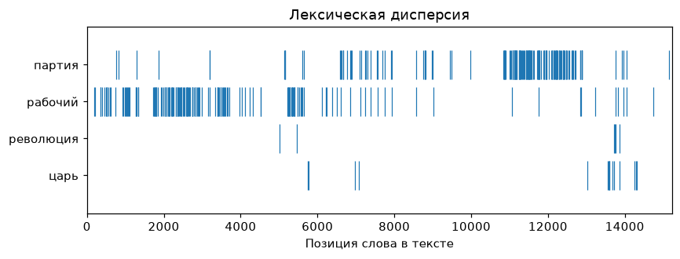
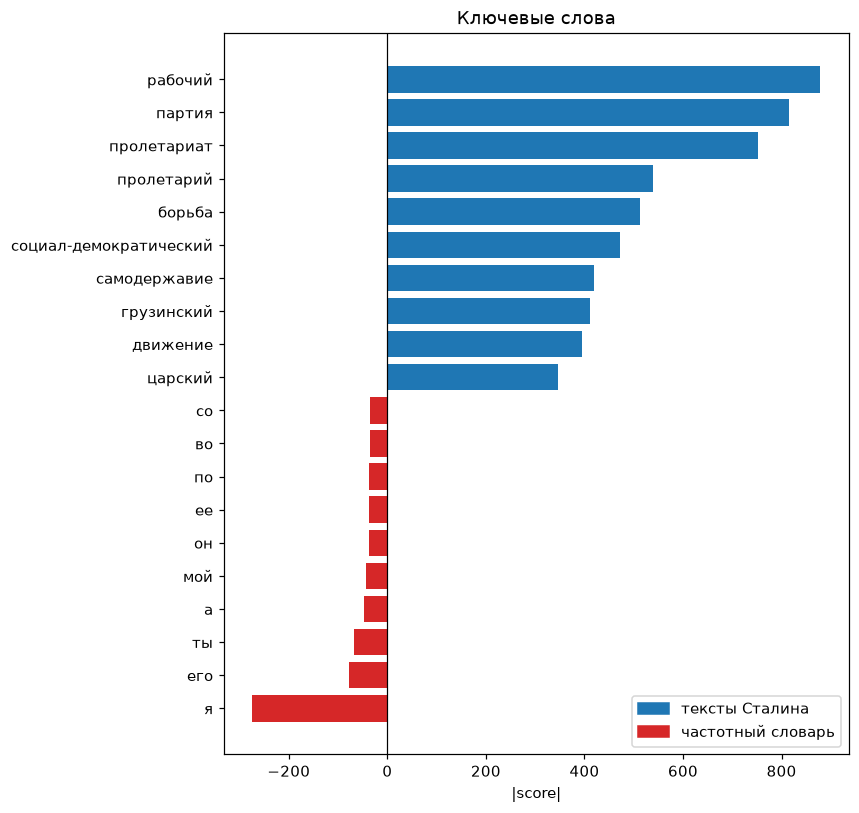

# Корпусные графики

Графики к [корпусным мерам](../corpus/keyness.md): лексическая дисперсия - где в тексте встречается слово, диаграмма ключевых слов по результатам [`keyness`](../corpus/keyness.md) и сеть коллокаций по результатам [`collocations`](../corpus/collocations.md). Функции matplotlib принимают оси `ax` и возвращают `Axes`: без `ax` создается новая фигура, с `ax` график ложится в сетку пользователя; сеть коллокаций строится graphviz и возвращает `Graph`, как [дерево слов](word_tree.md).

Это функции ядра [anyTS](https://sergeyshk.github.io/anyTS/visualizers/corpus/) с русскими подписями графиков matplotlib из `ruts.constants.VISUALIZER_LABELS` по умолчанию; `labels` задает подписи поверх них, а пара строк, переданная `keyness_plot`, заменяет две подписи легенды, остальные остаются русскими. `dispersion_plot` снимает знаки ударения со слов и с `targets`.

## Лексическая дисперсия { #dispersion_plot }

<!-- core: visualizers/corpus.md:dispersion_plot d906327 -->
``` {.python .signature}
dispersion_plot(words, targets, ax=None, labels=None)
```

Строка на каждое слово из `targets` и штрих на позиции каждого его вхождения в текст. Слова сравниваются как есть: регистр и лемматизация - на стороне извлечения слов.

| Параметр | Тип | По умолчанию | Описание |
| :------- | :-- | :----------- | :------- |
| `words` | `list[str]` | - | Слова текста по порядку |
| `targets` | `list[str]` | - | Слова, вхождения которых показываются |
| `ax` | `Axes` | `None` | Оси для графика |
| `labels` | `dict[str, str]` | `None` | Подписи поверх подписей по умолчанию: `title`, `xlabel` |

Слова или `targets`, которые не список строк, дают `SourceTypeError`, отсутствие слов или `targets` - `SourceError`; подписи, которые отвергает `merge_labels`, и `ax`, который не `Axes` matplotlib, дают `ParameterError`.

Слова извлекает [`WordsExtractor`](../extractors/words.md): в нижнем регистре - с `lowercase=True`, леммы - с `use_lexemes=True`.

## Диаграмма ключевых слов { #keyness_plot }

<!-- core: visualizers/corpus.md:keyness_plot f2f89b3 -->
``` {.python .signature}
keyness_plot(positive, negative=(), top_n=20, labels=None, field='score', log=False, ax=None)
```

Расходящиеся горизонтальные столбцы: слова из `positive` вправо, из `negative` (результата `keyness` с `positive=False`) влево, по `top_n` с каждой стороны. Длина столбца - модуль значения поля `field` (`score`, `g2`, `log_ratio`), так что сторона задается списком, а не знаком меры; слова с неопределенным или бесконечным значением пропускаются. Для отношения шансов (от 0 до бесконечности, единица - шансы равны) `log=True` откладывает модуль $\log_2$ значения, симметричный относительно единицы.

| Параметр | Тип | По умолчанию | Описание |
| :------- | :-- | :----------- | :------- |
| `positive` | `list[Keyword]` | - | Положительные ключевые слова |
| `negative` | `list[Keyword]` | `()` | Отрицательные ключевые слова |
| `top_n` | `int` | `20` | Количество слов с каждой стороны |
| `labels` | `dict[str, str]` / `tuple[str, str]` | `None` | Подписи поверх подписей по умолчанию: `title`, `xlabel` и `xlabel_log` (строки формата с `field`), `target` и `reference` (легенда); пара строк задает только легенду |
| `field` | `str` | `'score'` | Поле `Keyword`, значения которого откладываются |
| `log` | `bool` | `False` | Откладывать $\log_2$ значения - для отношения шансов |
| `ax` | `Axes` | `None` | Оси для графика |

Ключевые слова, которые не список, дают `SourceTypeError`, а отсутствие ключевого слова с конечным значением - `SourceError`. Неизвестное поле `field`, `top_n`, который не целое число не меньше единицы, подписи, которые отвергает `merge_labels`, или легенда, которая не пара, и `ax`, который не `Axes` matplotlib, дают `ParameterError`.

## Сеть коллокаций { #collocation_network }

<!-- core: visualizers/corpus.md:collocation_network 5af4d04 -->
``` {.python .signature}
collocation_network(collocations, top_n=None)
```

Неориентированный граф в раскладке `neato`: узлы - слова, размер шрифта по частоте, ребра - пары, толщина и подпись по мере. Пара слова с самим собой (слово, повторенное внутри окна) была бы петлей и отбрасывается до `top_n`. Для отрисовки нужны исполняемые файлы [Graphviz](https://graphviz.org/download/); Jupyter отображает граф, а `graph.render("network")` сохраняет файл png.

| Параметр | Тип | По умолчанию | Описание |
| :------- | :-- | :----------- | :------- |
| `collocations` | `list[Collocation]` | - | Коллокации |
| `top_n` | `int` | `None` | Количество пар с начала списка; `None` - все |

Коллокации, которые не список, дают `SourceTypeError`, отсутствие пары из двух разных слов - `SourceError`, а `top_n`, который не целое число не меньше единицы, - `ParameterError`.

Графики по 12 текстам набора данных [StalinWorks](../datasets/stalinworks.md):

``` python
from ruts import WordsExtractor
from ruts.corpus import collocations, keyness
from ruts.datasets import FreqDict, StalinWorks
from ruts.visualizers import collocation_network, dispersion_plot, keyness_plot

texts = list(StalinWorks().get_texts(limit=12))
we = WordsExtractor(use_lexemes=True, lowercase=True, filter_nums=True)
lemmas = [lemma for text in texts for lemma in we.extract(text)]
words = [word for text in texts for word in WordsExtractor(filter_nums=True).extract(text)]

dispersion_plot(lemmas, ["партия", "рабочий", "революция", "царь"])

freq_dict = FreqDict()
keyness_plot(
    keyness(words, freq_dict, min_freq=5, top_n=10),
    keyness(words, freq_dict, positive=False, min_freq=5, top_n=10),
    labels=("тексты Сталина", "частотный словарь"),
)

graph = collocation_network(collocations(lemmas, window=3, min_freq=5, top_n=25))
graph.render("network", format="png")
```

{: .center }

{: .center }
