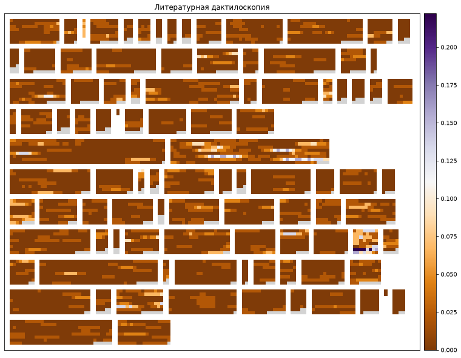

# Literature fingerprinting

``` {.python .signature}
fingerprinting(texts, segment_len=10, metric=None, x_size=800, y_size=600, cmap='PuOr', ax=None, labels=None)
```

--8<-- "visualizers/fingerprinting.md:fingerprinting"

The function is that of the [anyTS](https://sergeyshk.github.io/anyTS/visualizers/fingerprinting/) core with the Russian title of `ruts.constants.VISUALIZER_LABELS` by default, which `labels` replaces; the measures of [lexical diversity](../stats/diversity_stats.md) of ruTS, functions of a list of words such as `calc_ttr` or `calc_simpson_index`, serve as the `metric`.

The visualization of 100 texts of the [SovChLit](../datasets/sovchlit.md) dataset:

``` python
from ruts import WordsExtractor
from ruts.datasets import SovChLit
from ruts.diversity_stats import calc_simpson_index
from ruts.visualizers import fingerprinting

we = WordsExtractor(lowercase=True)
words = [we.extract(text) for text in SovChLit().get_texts(limit=100)]
ax = fingerprinting(words, metric=calc_simpson_index, x_size=1000, y_size=800)
ax.figure.savefig("fingerprinting.png")
```

{: .center }

## Parameters

| Parameter | Type | Default | Description |
| :-------- | :--- | :------ | :---------- |
| `texts` | `list[list[str]]` | - | List of lists of words |
| `segment_len` | `int` | `10` | Size of a segment |
| `metric` | `Callable` | `None` | Function of a measure of lexical diversity; `calc_ttr` by default |
| `x_size` | `int` | `800` | Half the width of the drawing area, greater than 25 (the margin between the blocks) |
| `y_size` | `int` | `600` | Half the height of the drawing area, which grows when the blocks need more |
| `cmap` | `str` | `'PuOr'` | Colour map |
| `ax` | `Axes` | `None` | Axes of matplotlib for the plot; if not given, a 15×10 figure is created |
| `labels` | `dict[str, str]` | `None` | Labels over the defaults: `title` |

The function returns the `Axes` with the visualization, set to an equal aspect so the squares stay square; the figure is `ax.figure`. Texts that are not a list of lists of strings and a `metric` that cannot be called raise `SourceTypeError`, a list without texts or a text without words `SourceError`. A `segment_len` or a `y_size` that is not an integer above zero, an `x_size` that is not an integer above 25, an unknown `cmap`, labels that `merge_labels` refuses and an `ax` that is not a matplotlib `Axes` raise `ParameterError`.
