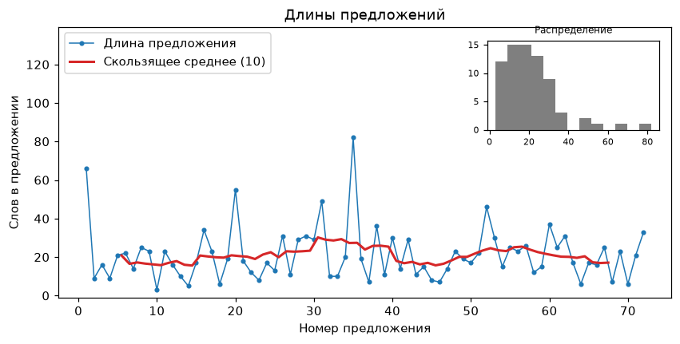

# Длины предложений

``` {.python .signature}
sentence_lengths_plot(source, window=10, inset=True, ax=None, labels=None, sents_extractor=None, words_extractor=None)
```

<!-- core: visualizers/sentences.md:sentence_lengths_plot 36b6cdc -->
Кривая длин предложений - ритм текста: длина каждого предложения в словах по порядку, скользящее среднее по `window` предложениям и врезка с гистограммой длин. Чередование коротких и длинных предложений - редакторский признак живого текста, ровная кривая - монотонного. Функция принимает оси `ax` и возвращает `Axes`.

Это функции ядра [anyTS](https://sergeyshk.github.io/anyTS/visualizers/sentences/); строку ruTS делит на предложения и слова сегментатором [anySeg](https://github.com/SergeyShk/anySeg), а если задан один экстрактор, второй - русский [`SentsExtractor`](../extractors/sentences.md) или [`WordsExtractor`](../extractors/words.md). Подписи по умолчанию - русские из `ruts.constants.VISUALIZER_LABELS`; `labels` задает подписи поверх них.

Кривая первого текста набора данных [StalinWorks](../datasets/stalinworks.md):

``` python
from ruts.datasets import StalinWorks
from ruts.visualizers import sentence_lengths_plot

text = next(StalinWorks().get_texts(limit=1))
sentence_lengths_plot(text, window=10)
```

{: .center }

## Параметры

<!-- core: visualizers/sentences.md:sentence_lengths_plot-parameters 1d34170 -->
| Параметр | Тип | По умолчанию | Описание |
| :------- | :-- | :----------- | :------- |
| `source` | `str` / `Doc` / `Document` / `Iterable[int]` | - | Текст, объект Doc или Document либо длины предложений (список, массив numpy, Series) |
| `window` | `int` | `10` | Окно скользящего среднего в предложениях |
| `inset` | `bool` | `True` | Показывать врезку с гистограммой |
| `ax` | `Axes` | `None` | Оси для графика |
| `labels` | `dict[str, str]` | `None` | Подписи поверх подписей по умолчанию: `title`, `xlabel`, `ylabel`, `length` (кривая), `average` (строка формата с `window`), `distribution` (врезка) |
| `sents_extractor` | `SentsExtractor` | `None` | Инструмент для извлечения предложений строки или `Doc` без предложений вместо предложений документа |
| `words_extractor` | `WordsExtractor` | `None` | Инструмент для извлечения слов предложения строки или `Doc` без предложений вместо слов документа |

Источник и экстракторы дают ошибки `sentence_lengths`, а отсутствие предложений - `SourceError`; `window`, который не целое число не меньше единицы, подписи, которые отвергает `merge_labels`, и `ax`, который не `Axes` matplotlib, дают `ParameterError`.

## Длины предложений { #sentence_lengths }

``` {.python .signature}
sentence_lengths(source, sents_extractor=None, words_extractor=None)
```

<!-- core: visualizers/sentences.md:sentence_lengths ad94ae1 -->
Длины предложений в словах по порядку: предложения документа текста, `Doc` или `Document` (`to_document`) и их слова с буквой или цифрой либо, если задан экстрактор, предложения и слова экстракторов на тексте строки или `Doc` без собственных предложений (начало предложения задано не у всех токенов, нет ни крючка, ни разбора); `Doc` с предложениями и `Document` сохраняют свои. Предложения без слов пропускаются. Готовые длины (неотрицательные целые числа в последовательности или итераторе) используются как есть. Аргументы - те же, что у `sentence_lengths_plot`.

Таблица, множество, словарь, байты, длина, которая не целое число, и экстрактор другого типа дают `SourceTypeError`, отрицательная длина - `SourceError`.

=== "Код"

    ``` python
    from ruts.visualizers import sentence_lengths

    sentence_lengths("Кот спит. Где пёс? - Ест, - сказала она.")
    sentence_lengths(text)[:5]
    ```

=== "Результат"

    ```
    [2, 2, 3]
    [66, 9, 16, 9, 21]
    ```
