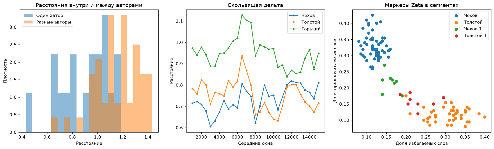

# Stylometric plots

Plots for [stylometry](../corpus/stylometry.md): a dendrogram, multidimensional scaling and histograms of the distances within and between authors from the [`delta`](../corpus/stylometry.md#delta) distance matrix, a principal component chart from the frequencies of the most frequent words, the distances of rolling Delta along a text, the segments of corpora by the markers of Zeta and Mendenhall curves of several texts - the set used in stylo to study the authorship of texts. The functions take axes `ax` and return `Axes`.

The functions are those of the [anyTS](https://sergeyshk.github.io/anyTS/visualizers/stylometry/) core with the Russian labels of `ruts.constants.VISUALIZER_LABELS` by default; `labels` puts the given labels over them. The frequencies of the principal components come from [`frequency_table`](../corpus/stylometry.md#delta), the distances along a text from [`rolling_delta`](../corpus/stylometry.md#rolling_delta), the segments from [`zeta_segments`](../corpus/stylometry.md#zeta) and the curves from [`mendenhall_curve`](../corpus/stylometry.md#mendenhall).

## Dendrogram { #dendrogram_plot }

--8<-- "visualizers/stylometry.md:dendrogram_plot"

## Principal components { #pca_plot }

--8<-- "visualizers/stylometry.md:pca_plot"

## Multidimensional scaling { #mds_plot }

--8<-- "visualizers/stylometry.md:mds_plot"

## Distances within and between authors { #delta_histogram_plot }

--8<-- "visualizers/stylometry.md:delta_histogram_plot"

## Rolling Delta { #rolling_delta_plot }

--8<-- "visualizers/stylometry.md:rolling_delta_plot"

## Zeta scatter { #zeta_scatter_plot }

--8<-- "visualizers/stylometry.md:zeta_scatter_plot"

## Mendenhall curves { #mendenhall_plot }

--8<-- "visualizers/stylometry.md:mendenhall_plot"

The plots of 8 texts of the [StalinWorks](../datasets/stalinworks.md) dataset:

``` python
import matplotlib.pyplot as plt

from ruts import WordsExtractor
from ruts.corpus import delta
from ruts.datasets import StalinWorks
from ruts.visualizers import dendrogram_plot, mds_plot, mendenhall_plot, pca_plot

we = WordsExtractor(use_lexemes=True, lowercase=True, filter_nums=True)
texts = StalinWorks().get_texts(limit=8)
corpus = {f"текст {i + 1}": we.extract(text) for i, text in enumerate(texts)}
distances = delta(corpus, n_mfw=100, variant="cosine")

fig, (left, right) = plt.subplots(1, 2, figsize=(13, 5))
dendrogram_plot(distances, ax=left)
pca_plot(corpus, n_mfw=100, ax=right)

fig, (left, right) = plt.subplots(1, 2, figsize=(13, 5))
mds_plot(distances, ax=left)
mendenhall_plot({name: corpus[name] for name in list(corpus)[:3]}, ax=right)
```

{: .center }

{: .center }

The plots of 12 works by Chekhov, Tolstoy and Gorky of the `prose` genre of the [RussianLiterature](../datasets/russianliterature.md) dataset: the distances between all the works, rolling Delta over the first work of Chekhov followed by the first work of Tolstoy with the other three works of each author as the references, and the segments by the markers of Zeta of Chekhov against Tolstoy:

``` python
from ruts.corpus import rolling_delta, zeta, zeta_segments
from ruts.datasets import RussianLiterature
from ruts.visualizers import delta_histogram_plot, rolling_delta_plot, zeta_scatter_plot

names = ("Чехов", "Толстой", "Горький")
rl = RussianLiterature()
corpus, authors = {}, {}
for author in names:
    texts = rl.get_texts(genre="prose", author=author, min_len=40000, max_len=200000, limit=4)
    for i, text in enumerate(texts, 1):
        corpus[f"{author} {i}"] = we.extract(text)
        authors[f"{author} {i}"] = author
known = {author: [corpus[f"{author} {i}"] for i in (2, 3, 4)] for author in names}
reference = {author: [word for words in known[author] for word in words] for author in names}
scores = zeta(known["Чехов"], known["Толстой"], segment_size=1000)
preferred = [score.word for score in scores[:200]]
avoided = [score.word for score in scores[-200:]]
corpora = {
    "Чехов": known["Чехов"],
    "Толстой": known["Толстой"],
    "Чехов 1": corpus["Чехов 1"],
    "Толстой 1": corpus["Толстой 1"],
}

fig, axes = plt.subplots(1, 3, figsize=(19, 5))
delta_histogram_plot(delta(corpus, n_mfw=100, variant="cosine"), authors, ax=axes[0])
rolling_delta_plot(
    rolling_delta(reference, corpus["Чехов 1"] + corpus["Толстой 1"], window=2000, step=500),
    ax=axes[1],
)
zeta_scatter_plot(zeta_segments(corpora, preferred, avoided, segment_size=1000), ax=axes[2])
```

{: .center }
