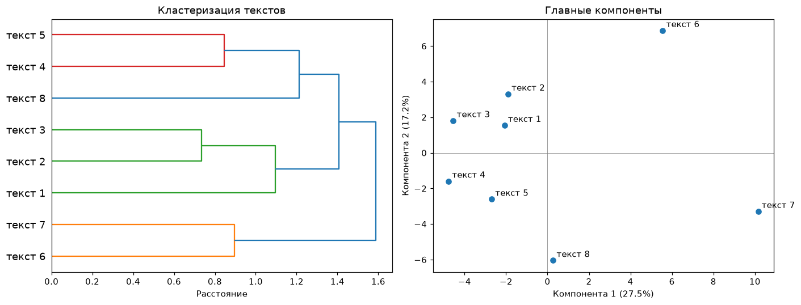
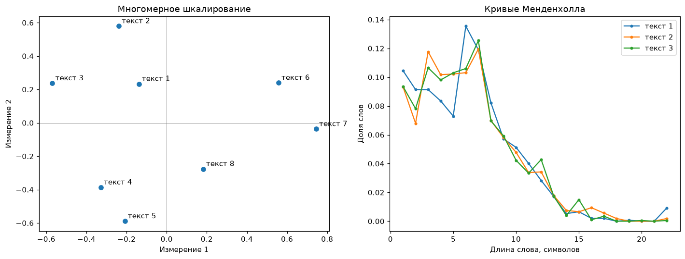

# Стилометрические графики

Графики к [стилометрии](../corpus/stylometry.md): дендрограмма и многомерное шкалирование по матрице расстояний [`delta`](../corpus/stylometry.md#delta), диаграмма главных компонент по частотам самых частых слов и кривые Менденхолла нескольких текстов - набор, которым в stylo смотрят на кластеризацию текстов по авторам. Функции принимают оси `ax` и возвращают `Axes`.

Это функции ядра [anyTS](https://sergeyshk.github.io/anyTS/visualizers/stylometry/) с русскими подписями из `ruts.constants.VISUALIZER_LABELS` по умолчанию; `labels` задает подписи поверх них. Частоты для главных компонент дает [`frequency_table`](../corpus/stylometry.md#delta), кривые - [`mendenhall_curve`](../corpus/stylometry.md#mendenhall).

## Дендрограмма { #dendrogram_plot }

<!-- core: visualizers/stylometry.md:dendrogram_plot e3f6319 -->
``` {.python .signature}
dendrogram_plot(distances, method='ward', ax=None, labels=None)
```

Иерархическая кластеризация `scipy.cluster.hierarchy` по матрице расстояний между текстами, по умолчанию методом Уорда, как у [Evert и др. (2015)](https://aclanthology.org/W15-0709.pdf); листья подписываются по индексу матрицы. Столбцы берутся в порядке строк.

| Параметр | Тип | По умолчанию | Описание |
| :------- | :-- | :----------- | :------- |
| `distances` | `DataFrame` | - | Симметричная матрица расстояний с именами текстов в строках и столбцах, в любом порядке |
| `method` | `str` | `'ward'` | Метод объединения кластеров `scipy.cluster.hierarchy.linkage`: `single`, `complete`, `average`, `weighted`, `centroid`, `median` или `ward` |
| `ax` | `Axes` | `None` | Оси для графика |
| `labels` | `dict[str, str]` | `None` | Подписи поверх подписей по умолчанию: `title`, `xlabel` |

Матрица, в столбцах которой другие тексты, чем в строках, меньше двух текстов, бесконечное или отрицательное расстояние, асимметрия или расстояние на диагонали дают `SourceError` до создания фигуры. Расстояния, которые не `DataFrame` чисел, дают `SourceTypeError`; неизвестный `method`, подписи, которые отвергает `merge_labels`, и `ax`, который не `Axes` matplotlib, дают `ParameterError`.

## Главные компоненты { #pca_plot }

<!-- core: visualizers/stylometry.md:pca_plot b21b905 -->
``` {.python .signature}
pca_plot(corpus, n_mfw=100, culling=0.0, ax=None, labels=None)
```

Метод главных компонент по z-оценкам относительных частот самых частых единиц (`frequency_table`, `z_scores`): тексты на плоскости двух первых компонент с их именами, доли объясненной дисперсии - в подписях осей.

| Параметр | Тип | По умолчанию | Описание |
| :------- | :-- | :----------- | :------- |
| `corpus` | `dict[str, list[str]]` | - | Единицы текстов по именам текстов |
| `n_mfw` | `int` | `100` | Число самых частых единиц; `None` - все |
| `culling` | `float` | `0.0` | Наименьшая доля текстов, в которых встречается единица |
| `ax` | `Axes` | `None` | Оси для графика |
| `labels` | `dict[str, str]` | `None` | Подписи поверх подписей по умолчанию: `title`, `xlabel` и `ylabel` (строки формата с объясненной долей `share`) |

Корпус, `n_mfw` и `culling` дают ошибки `frequency_table`, а меньше трех текстов - `SourceError`; подписи, которые отвергает `merge_labels`, и `ax`, который не `Axes` matplotlib, дают `ParameterError`.

## Многомерное шкалирование { #mds_plot }

<!-- core: visualizers/stylometry.md:mds_plot fee8015 -->
``` {.python .signature}
mds_plot(distances, ax=None, labels=None)
```

Классическое многомерное шкалирование (Torgerson 1952) по любой матрице расстояний: два главных собственных вектора дважды центрированной матрицы квадратов расстояний, так что расстояния между точками приближают расстояния матрицы. Столбцы берутся в порядке строк.

| Параметр | Тип | По умолчанию | Описание |
| :------- | :-- | :----------- | :------- |
| `distances` | `DataFrame` | - | Симметричная матрица расстояний с именами текстов в строках и столбцах, в любом порядке |
| `ax` | `Axes` | `None` | Оси для графика |
| `labels` | `dict[str, str]` | `None` | Подписи поверх подписей по умолчанию: `title`, `xlabel`, `ylabel` |

Матрица, в столбцах которой другие тексты, чем в строках, меньше двух текстов, бесконечное или отрицательное расстояние, асимметрия или расстояние на диагонали дают `SourceError` до создания фигуры. Расстояния, которые не `DataFrame` чисел, дают `SourceTypeError`; подписи, которые отвергает `merge_labels`, и `ax`, который не `Axes` matplotlib, дают `ParameterError`.

## Кривые Менденхолла { #mendenhall_plot }

<!-- core: visualizers/stylometry.md:mendenhall_plot 921690d -->
``` {.python .signature}
mendenhall_plot(corpus, ax=None, labels=None)
```

Доли слов по длине в символах (`mendenhall_curve`) для каждого текста на одном графике; длина, которой нет ни у одного слова, рисуется в нуле.

| Параметр | Тип | По умолчанию | Описание |
| :------- | :-- | :----------- | :------- |
| `corpus` | `dict[str, list[str]]` | - | Слова текстов по именам текстов |
| `ax` | `Axes` | `None` | Оси для графика |
| `labels` | `dict[str, str]` | `None` | Подписи поверх подписей по умолчанию: `title`, `xlabel`, `ylabel` |

Корпус, который не словарь списков строк, дает `SourceTypeError`, отсутствие текстов или текст без слов - `SourceError`; подписи, которые отвергает `merge_labels`, и `ax`, который не `Axes` matplotlib, дают `ParameterError`.

Графики по 8 текстам набора данных [StalinWorks](../datasets/stalinworks.md):

``` python
import matplotlib.pyplot as plt

from ruts import WordsExtractor
from ruts.corpus import delta
from ruts.datasets import StalinWorks
from ruts.visualizers import dendrogram_plot, mds_plot, mendenhall_plot, pca_plot

we = WordsExtractor(use_lexemes=True, lowercase=True, filter_nums=True)
texts = StalinWorks().get_texts(limit=8)
corpus = {f"текст {i + 1}": we.extract(text) for i, text in enumerate(texts)}
distances = delta(corpus, n_mfw=100, variant="cosine")

fig, (left, right) = plt.subplots(1, 2, figsize=(13, 5))
dendrogram_plot(distances, ax=left)
pca_plot(corpus, n_mfw=100, ax=right)

fig, (left, right) = plt.subplots(1, 2, figsize=(13, 5))
mds_plot(distances, ax=left)
mendenhall_plot({name: corpus[name] for name in list(corpus)[:3]}, ax=right)
```

{: .center }

{: .center }
