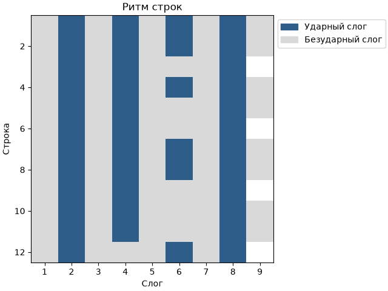

# Rhythm of the lines

--8<-- "visualizers/verse.md:rhythm_plot"

It is the function of the [anyTS](https://sergeyshk.github.io/anyTS/visualizers/verse/) core with the Russian labels of `ruts.constants.VISUALIZER_LABELS` by default; `labels` sets labels over them. The patterns of the lines are the `patterns` of [`VerseStats`](../stats/verse_stats.md), the character of a stressed syllable is `PATTERN_STRESSED` of `ruts.verse_stats`.

Two stanzas of Pushkin's «Winter Morning» - iambic tetrameter with the stress skipped on the sixth syllable:

``` python
from ruts import VerseStats
from ruts.verse_stats import PATTERN_STRESSED
from ruts.visualizers import rhythm_plot

vs = VerseStats(text)
rhythm_plot(vs.patterns, PATTERN_STRESSED)
```

{: .center }
