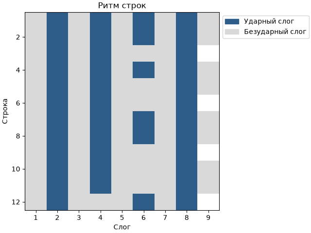

# Ритм строк

<!-- core: visualizers/verse.md:rhythm_plot 0905b0d -->
``` {.python .signature}
rhythm_plot(patterns, stressed, ax=None, labels=None)
```

Строка на каждую строку стиха и клетка на каждый слог ее схемы, с номерами от 1: ударные слоги - одним цветом, остальные - другим, после конца строки - пусто, так что столбцы метра и строки, которые его нарушают, видны сразу.

| Параметр | Тип | По умолчанию | Описание |
| :------- | :-- | :----------- | :------- |
| `patterns` | `list[str]` | - | Схемы строк, символ на каждый слог |
| `stressed` | `str` | - | Символ ударного слога в схемах |
| `ax` | `Axes` | `None` | Оси для графика |
| `labels` | `dict[str, str]` | `None` | Подписи поверх подписей по умолчанию: `title`, `xlabel`, `ylabel`, `stressed`, `unstressed` (легенда) |

Схемы, которые не список строк, дают `SourceTypeError`, отсутствие строк - `SourceError`; `stressed`, который не один символ, подписи, которые отвергает `merge_labels`, и `ax`, который не `Axes` matplotlib, дают `ParameterError`.

Это функция ядра [anyTS](https://sergeyshk.github.io/anyTS/visualizers/verse/) с русскими подписями из `ruts.constants.VISUALIZER_LABELS` по умолчанию; `labels` задает подписи поверх них. Схемы строк - `patterns` [`VerseStats`](../stats/verse_stats.md), символ ударного слога - `PATTERN_STRESSED` модуля `ruts.verse_stats`.

Две строфы «Зимнего утра» Пушкина - четырехстопный ямб с пропусками ударения на шестом слоге:

``` python
from ruts import VerseStats
from ruts.datasets import PoetryCorpus
from ruts.verse_stats import PATTERN_STRESSED
from ruts.visualizers import rhythm_plot

records = PoetryCorpus().get_records(author="Александр Пушкин")
poem = next(record["text"] for record in records if record["title"] == "Зимнее утро")
vs = VerseStats("\n".join(poem.split("\n")[:12]))
rhythm_plot(vs.patterns, PATTERN_STRESSED)
```

{: .center }
