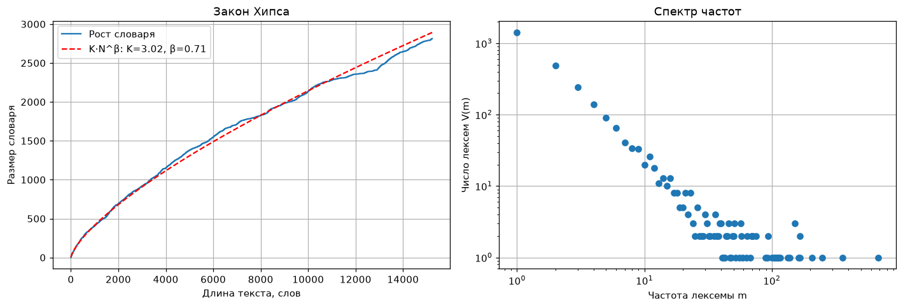

# Vocabulary growth and frequency spectrum

Two plots about the word distribution of a text complementing [Zipf's law](zipf.md): vocabulary growth with text length by Heaps' law and the frequency spectrum - how many lexemes occur exactly once, twice, three times. Both plots exist in zipfR (`plot.vgc`, `plot.spc`). The functions take axes `ax` and return `Axes`.

The functions are those of the [anyTS](https://sergeyshk.github.io/anyTS/visualizers/vocabulary/) core with the Russian labels of `ruts.constants.VISUALIZER_LABELS` by default; `labels` puts the given labels over them. The fit of Heaps' law is described in [`fit_heaps`](../stats/diversity_stats.md#heaps_beta) and the spectrum in [`calc_frequency_spectrum`](../stats/diversity_stats.md#frequency_spectrum).

## Heaps' law { #heaps_plot }

--8<-- "visualizers/vocabulary.md:heaps_plot"

## Frequency spectrum { #frequency_spectrum_plot }

--8<-- "visualizers/vocabulary.md:frequency_spectrum_plot"

The plots of 12 texts of the [StalinWorks](../datasets/stalinworks.md) dataset:

``` python
import matplotlib.pyplot as plt

from ruts import WordsExtractor
from ruts.datasets import StalinWorks
from ruts.visualizers import frequency_spectrum_plot, heaps_plot

we = WordsExtractor(use_lexemes=True, lowercase=True, filter_nums=True)
lemmas = [lemma for text in StalinWorks().get_texts(limit=12) for lemma in we.extract(text)]

fig, (left, right) = plt.subplots(1, 2, figsize=(13, 4.5))
heaps_plot(lemmas, ax=left)
frequency_spectrum_plot(lemmas, ax=right)
```

{: .center }
