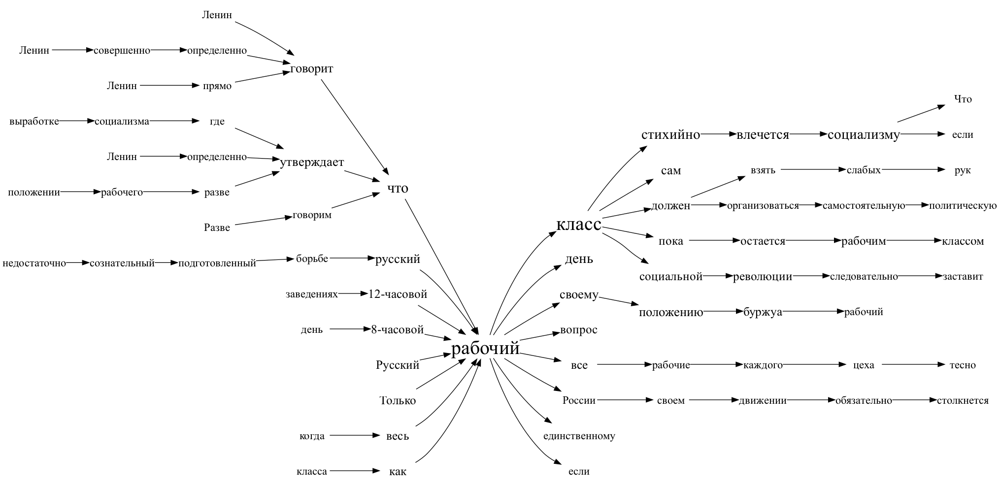

# Word tree

--8<-- "visualizers/word_tree.md:wordtree"

The function is that of the [anyTS](https://sergeyshk.github.io/anyTS/visualizers/word_tree/) core; stress marks are stripped from the texts and from `keyword`.

The tree of the sentences of 50 texts of the [StalinWorks](../datasets/stalinworks.md) dataset:

``` python
from ruts import SentsExtractor, WordsExtractor
from ruts.datasets import StalinWorks
from ruts.visualizers import wordtree

se = SentsExtractor()
we = WordsExtractor(min_len=3)
texts = StalinWorks().get_texts(limit=50)
words = [we.extract(sent) for text in texts for sent in se.extract(text)]
tree = wordtree(words, "рабочий", max_n=6)
tree.render("wordtree", format="png")
```

{: .center }

## Parameters

--8<-- "visualizers/word_tree.md:wordtree-parameters"
