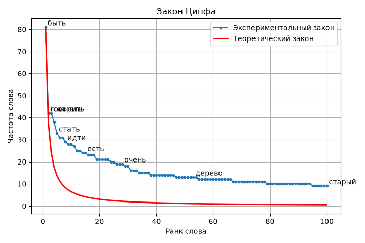

# Zipf's law

--8<-- "visualizers/zipf.md:zipf"

The functions are those of the [anyTS](https://sergeyshk.github.io/anyTS/visualizers/zipf/) core with the Russian labels of `ruts.constants.VISUALIZER_LABELS` by default; `labels` puts the given labels over them, for instance `labels={"title": "Закон Ципфа в SovChLit"}`.

The plot of 100 texts of the [SovChLit](../datasets/sovchlit.md) dataset:

``` python
from collections import Counter

from ruts import WordsExtractor
from ruts.datasets import SovChLit
from ruts.style_stats import is_stopword
from ruts.visualizers import zipf

text = "\n".join(SovChLit().get_texts(limit=100))
we = WordsExtractor(use_lexemes=True, filter_nums=True)
counts = Counter(word for word in we.extract(text) if not is_stopword(word))
ax = zipf(counts, num_words=100, num_labels=10, log=False, show_theory=True, alpha=1.1)
ax.figure.savefig("zipf.png")
```

{: .center }

## Parameters

--8<-- "visualizers/zipf.md:zipf-parameters"

The Zipf-Mandelbrot fit is described in [`fit_zipf_mandelbrot`](../stats/diversity_stats.md#fit_zipf_mandelbrot).

## Theoretical law { #zipf_theory }

--8<-- "visualizers/zipf.md:zipf_theory"
